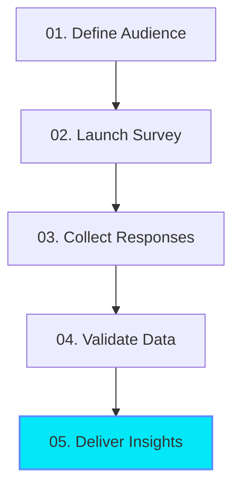

# EvoGlobalInsight (EGI) Website Content & Copy Deck

Welcome to the **EvoGlobalInsight (EGI)** codebase. This README serves as a comprehensive content guide, housing the exact marketing copy, metrics, structured data, and section highlights extracted from each page of the application. 

---

## 📌 Table of Contents
1. [Home Page (`/`)](#1-home-page)
2. [About Us (`/about`)](#2-about-us)
3. [Services (`/services`)](#3-services)
4. [Case Studies (`/case-studies`)](#4-case-studies)
5. [Industries (`/industries`)](#5-industries)
6. [Insights (`/insights`)](#6-insights)
7. [Contact Us (`/contact`)](#7-contact-us)

---

## 1. Home Page (`/`)
* **Page File:** [page.tsx](file:///c:/Users/Himanshu/Desktop/website/app/page.tsx)
* **Components:** Location under [components/home/](file:///c:/Users/Himanshu/Desktop/website/components/home/)

### 🚀 Hero Section (`Hero.tsx`)
* **Trust Badge:** 
  * Rating: `4.9/5 Rating` (5-Star rated)
  * Social Proof: `Trusted by 500+ teams`
* **Headline (Dynamic depending on target audience toggle):**
  * **For Brands:** Reach Verified `[Respondents. / Audiences. / Professionals. / Consumers. / Experts]` • Collect **Better Insights.**
  * **For Panelists:** Your Voice Shapes `[Global / Future / Tomorrow's / Everyday / Leading]` Products. • Get **Rewarded.**
* **Sub-Headline:**
  * **For Brands:** *"Field your surveys to premium respondent panels, bypass bot detection with verified identity matches, and collect high-quality insights to guide your next strategic move."*
  * **For Panelists:** *"Join our elite panel of verified respondents. Share your perspective on global brands, participate in corporate surveys, and earn rewards for sharing your valuable insights."*
* **Call to Actions:**
  * Primary: `Book a Demo` (links to `/contact`)
  * Secondary: `View Case Studies` (links to `/case-studies`)
* **Core Trust Metrics:**
  * `250K+` Responses Generated
  * `500+` Campaigns Delivered
  * `92%` Avg Completion Rate
  * `99.7%` Fraud Detection Accuracy
* **Industry & Compliance Accreditations:**
  * **nglcc:** National LGBT Chamber of Commerce
  * **IAC:** Internet Advertising Competition
  * **VEGA:** Digital Awards 2025 Gold Winner
  * **NYX:** Grand Winner Awards
  * **MUSE:** Creative Awards Official Winner

### ⚡ What We Do (`WhatWeDo.tsx`)
* **Headline:** Survey Solutions That Turn Questions Into **Clear Answers**.
* **Key Metrics Cards:**
  * **250K+** Responses Generated *(Verified Respondent Network)*
  * **500+** Campaigns Delivered *(Across Global Markets)*
  * **92%** Completion Rate *(Industry Leading Engagement)*
  * **50+** Countries Reached *(Multi-Language Panels)*
  * **99.7%** Fraud Detection Accuracy *(Verified Insights)*

### 🛠️ How We Work (`HowWeWork.tsx`)
* **Headline:** From Survey Brief To Actionable Data — **In Three Moves**.
* **Phases:**
  1. **Define (Phase 01):** *"We understand your survey objectives and design the right methodology to reach your audience."*
  2. **Market (Phase 02):** *"We market your survey to verified respondents across 50+ countries and 30+ languages."*
  3. **Deliver (Phase 03):** *"You receive clean data, actionable insights and strategic recommendations."*

### 🔄 The Process (`WhyChooseUs.tsx`)
* **Headline:** THE **PROCESS.**
* **Subcopy:** *"From survey design to verified insights, our proven research workflow delivers reliable, high-quality data at scale."*
* **Workflow Steps:**
  1. **Survey Design:** Research objectives, questionnaire creation, and sampling strategy.
  2. **Audience Recruitment:** Verified respondent sourcing, targeted outreach, and panel activation.
  3. **Data Collection:** Survey deployment, real-time response monitoring, and quality control.
  4. **Insight Delivery:** Deep data analysis, report generation, and actionable recommendations.

### 🏢 Featured Industries (`IndustriesMarquee.tsx`)
* **Headline:** DEEP EXPERTISE ACROSS THE CATEGORIES THAT **MOVE THE WORLD**.
* **Categories:** Healthcare, Finance, Consumer Goods, Education, Automotive, Technology, Retail, Telecommunications, Travel, Entertainment.
* **Mascot Speech:** `"EGI: VERIFIED INSIGHTS AHEAD"`

### 📈 Research Impact (`Testimonials.tsx`)
* **Headline:** Data-Driven Proof. **Verified Results.**
* **Subcopy:** *"We help ambitious research leaders reach global audiences, consolidate vendor costs, and collect clean survey data with maximum methodology support."*
* **Testimonials & Success Stories:**

| Company | Research Objective | Key Impact Metric | Quote | Author & Role |
| :--- | :--- | :--- | :--- | :--- |
| **Lumen Audio** | Global Product Launch Validation | **92%** Completion Rate *(48,291 Responses)* | *"EvoGlobalInsight delivered insights in two weeks that would have taken our internal team a quarter. The launch hit number one in its category."* | Amelia Chen (VP Product) |
| **Northstar Bank** | B2B Financial Sentiment Tracking | **99.7%** Fraud Detection Accuracy | *"The most rigorous panel I've worked with in 15 years. Their methodology team doesn't just hand off data — they help us decide."* | Marcus Doyle (Head of Insights) |
| **Brightleaf Health** | Healthcare Tracker Consolidation | **60%** Vendor Cost Reduction *(250K+ Monthly)* | *"We replaced four vendors with EvoGlobalInsight. Faster, cleaner data, and a partner that actually understands our category."* | Priya Raman (CMO) |

### 🎯 Final Call to Action (`FinalCTA.tsx`)
* **Headline:** Let's Turn Responses Into **Real Decisions.**
* **Subcopy:** *"Talk to our research strategists and receive a tailored proposal within 48 hours. Access verified respondents, global audiences, and actionable insights."*
* **CTA Button:** `Start Your Research Project`

---

## 2. About Us (`/about`)
* **Page File:** [about/page.tsx](file:///c:/Users/Himanshu/Desktop/website/app/about/page.tsx)

### 🌟 Page Hero
* **Headline:** We help organizations make decisions **with confidence**.

### 🎯 Mission & Vision
> [!NOTE]
> **Our Mission:** To replace gut-feel decisions with rigorous, human-centered evidence — so every product, campaign, and policy is shaped by the people it serves.

> [!TIP]
> **Our Vision:** A world where understanding people is the default, not the differentiator — and where every voice has a clear path to the decisions that affect it.

### 💎 Core Values
* **Integrity:** Methodology and data quality we’d stake our name on.
* **Accuracy:** Precision over speed when the answer matters.
* **Innovation:** Always testing new methods, never reusing yesterday’s playbook.
* **Client Success:** We win when your decision lands.

### 👥 Leadership Team
* **Dr. Maya Okafor:** Co-founder & CEO
* **Jonas Lindqvist:** Co-founder & Head of Methodology
* **Sofia Marín:** Chief Research Officer
* **Tariq Yusuf:** VP, Global Panels

### 🌍 Global Reach
* **Headline:** Active panels across 50+ countries.
* Interactive world connection map linking multiple regional hub servers dynamically.

---

## 3. Services (`/services`)
* **Page File:** [services/page.tsx](file:///c:/Users/Himanshu/Desktop/website/app/services/page.tsx)
* **Components:** Location under [components/services/](file:///c:/Users/Himanshu/Desktop/website/components/services/)

### 🚀 Services Hero (`ServicesHero.tsx`)
* **Headline:** REACH VERIFIED AUDIENCES FOR BETTER **DECISIONS.**
* **Subcopy:** *"From targeted audience recruitment to survey distribution and response validation, we help organizations collect reliable insights at scale."*
* **Key Stats:**
  * **99.7%** Fraud Detection Accuracy
  * **50+** Countries Reached
  * **92%** Completion Rate
  * **250K+** Verified Respondents

### ⚙️ Interactive Solutions Platform
EGI operates a highly customized verification workflow pipeline:

1. **Define Audience:** Configure target profiles with demographical, regional, and industry selectors.
2. **Launch Survey:** Deploy surveys across dispatch channels and platform links immediately.
3. **Collect Responses:** Gather completions in real-time across devices and responsive screens.
4. **Validate Data:** Filter invalid responses using device logs and geo-verification checks.
5. **Deliver Insights:** Obtain clean, verified, and structured datasets ready for direct analysis.

### 🌐 Audience Demographics & Targeting Attributes
* **Audience Verticals:** B2B Tech Buyers, Healthcare Professionals, SMB Owners, Active Parents, Global Students, Niche Consumers.
* **Distribution Channels:** Panel API (Direct Integration), SMS Link (Mobile Direct), Email Send (Secure Templates), Mobile App (In-app intercept).
* **Validation Filters (EGI Shield):**
  * **VPN Proxy Checks:** Block residential proxies and IP mismatches.
  * **Speedrunner Match:** Reject submissions completed in under 15-120 seconds.
  * **Device Fingerprinting:** Verify unique hardware records.
  * **Behavioral Dynamics:** Keystroke dynamics and layout checks.
* **Audience Stats:**
  * **250K+ Verified Respondents:** Pre-screened panel members ready for survey dispatch.
  * **50+ Countries:** Global reach ensuring representative sampling.
  * **120+ Targeting Attributes:** Granular profile filters for pinpoint matching.
  * **92% Completion Rate:** Industry-leading participant retention.

---

## 4. Case Studies (`/case-studies`)
* **Page File:** [case-studies/page.tsx](file:///c:/Users/Himanshu/Desktop/website/app/case-studies/page.tsx)

### 📈 Strategic Engagements Index

#### 🔊 1. Consumer Electronics
* **Title:** Launching a category-leading wireless audio brand.
* **Challenge:** Launch a new product in a saturated category.
* **Solution:** Global consumer study across 8 markets with concept and pricing tests.
* **Outcome:** `+38%` pre-order conversion and #1 in category at launch.

#### 💳 2. Fintech Startup
* **Title:** Multi-country expansion playbook for a digital bank.
* **Challenge:** Identify priority markets for expansion.
* **Solution:** Multi-country survey + qualitative interviews with switchers.
* **Outcome:** `2.1x` customer acquisition in selected launch markets.

#### 🏥 3. Healthcare
* **Title:** Repositioning a 50-year-old wellness brand.
* **Challenge:** Reach younger consumers without alienating loyalists.
* **Solution:** Segmentation + brand tracker across 6 quarters.
* **Outcome:** `+22pt` unaided awareness in the 25-34 segment.

#### 🛒 4. Retail
* **Title:** Optimizing the omni-channel grocery experience.
* **Challenge:** Reduce cart abandonment in pickup ordering.
* **Solution:** Behavioral analytics + diary studies with active shoppers.
* **Outcome:** `-17%` abandonment, `+9%` basket size.

#### 🚗 5. Automotive
* **Title:** EV buyer journey decoded across 12 markets.
* **Challenge:** Build a unified buyer journey for a new EV lineup.
* **Solution:** 12-market quantitative + 60 in-depth interviews.
* **Outcome:** Refreshed dealer experience adopted globally.

#### 🎓 6. Education
* **Title:** Designing a curriculum students actually love.
* **Challenge:** Improve completion rates in self-paced courses.
* **Solution:** Mixed-methods study with 4,200 learners worldwide.
* **Outcome:** `+31%` course completion rate.

---

## 5. Industries (`/industries`)
* **Page File:** [industries/page.tsx](file:///c:/Users/Himanshu/Desktop/website/app/industries/page.tsx)
* **Components:** [StoryScrollSection.tsx](file:///c:/Users/Himanshu/Desktop/website/components/industries/StoryScrollSection.tsx)

### 🛠️ Industry Expertise
* **Headline:** Research expertise across **industries**.
* **Sub-Headline:** *"Category specialists who know your customer, your competitors, and the questions worth asking."*
* **Core Philosophy:** *"Real opinions. Real consumers. Real market intelligence."*
* **Pillars of Analysis:**
  * **INSIGHT:** Connect with verified consumers to gather authentic feedback.
  * **DATA:** Leverage advanced screening to validate business choices.
  * **AUDIENCE:** Tap into specific demographical brackets worldwide.
  * **RESEARCH:** Deploy combined methodologies for robust outcomes.
  * **GROWTH:** Turn unstructured consumer data into scaled expansion.
* **Copy Deck:**
  * *"We connect brands with verified consumers to gather authentic feedback, uncover buying behavior, and validate business decisions with confidence."*
  * *"Our research methodology combines targeted audiences, advanced screening, and actionable insights to help organizations make smarter strategic decisions."*

---

## 6. Insights (`/insights`)
* **Page File:** [insights/page.tsx](file:///c:/Users/Himanshu/Desktop/website/app/insights/page.tsx)

### 📰 EGI Methodology Articles & Publications
* **Headline:** Ideas, frameworks, and findings **worth reading**.
* **Sub-Headline:** *"Tactical pieces from our methodology team and a regular pulse on what we’re seeing across global panels."*
* **Categories:** Market Research, Consumer Behavior, Brand Strategy, Industry Trends.

#### 📚 Publications Index:
1. **Market Research:** *"How to size a market when the category doesn’t exist yet"* (7 min read)
2. **Consumer Behavior:** *"The post-loyalty consumer: what 5,000 shoppers told us"* (5 min read)
3. **Brand Strategy:** *"Tracking brand health without drowning in dashboards"* (6 min read)
4. **Industry Trends:** *"AI in research: where it helps, where it hurts"* (8 min read)
5. **Consumer Behavior:** *"Why your Gen Z segment is probably three segments"* (4 min read)
6. **Market Research:** *"A practical guide to concept testing in 2026"* (9 min read)
7. **Brand Strategy:** *"Naming, but with data: a repeatable process"* (6 min read)
8. **Industry Trends:** *"The state of mobile-first research worldwide"* (5 min read)

---

## 7. Contact Us (`/contact`)
* **Page File:** [contact/page.tsx](file:///c:/Users/Himanshu/Desktop/website/app/contact/page.tsx)

### ✉️ Contact Channels
* **Headline:** Contact us
* **Subcopy:** *"Get in touch and ask us anything. The difference between quantitative surveys and focus groups, can you start a study from Madagascar, which research methodology our team prefers - we answer it all."*
* **Form Inputs & Configuration:**
  * **Fields:** Name, Email, Phone, Interested in (Services Dropdown), Message Details.
  * **Dropdown Categories:**
    * Quantitative Surveys
    * Qualitative Focus Groups
    * B2B Expert Interviews
    * B2C Consumer Panels
    * Careers / Panelist Join
  * **Phone Prefixes Supported:** India (`+91`), Singapore (`+65`), USA (`+1`), Italy (`+39`).

### 📍 Global HQ Contact Details
* **Address:** EGI Workspace, Cyber City, Bangalore, India
* **Corporate Email:** hello@evoglobalinsight.com
* **Corporate Phone:** +91 99999 99999
* **Social Connections:** LinkedIn, Twitter, YouTube, Instagram, Chat
